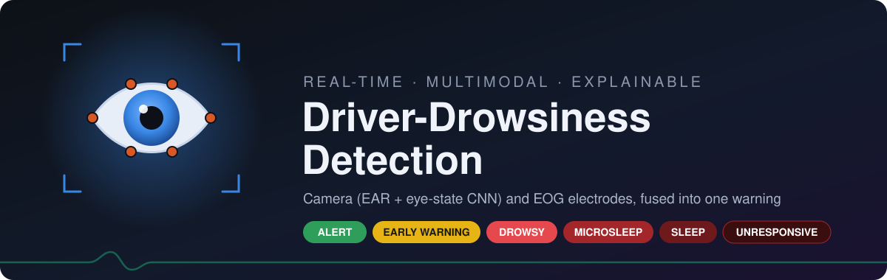
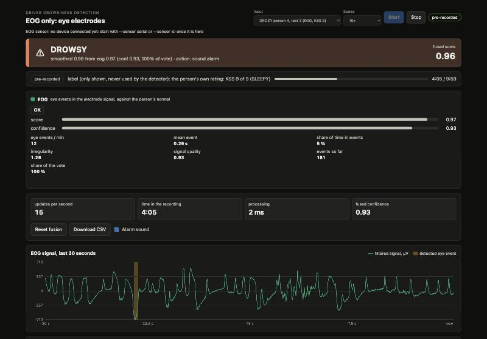
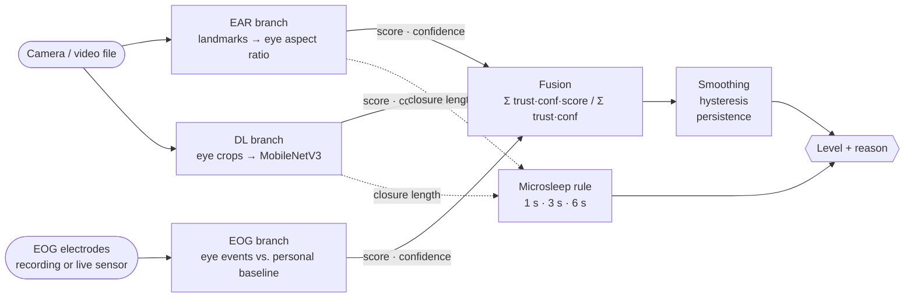
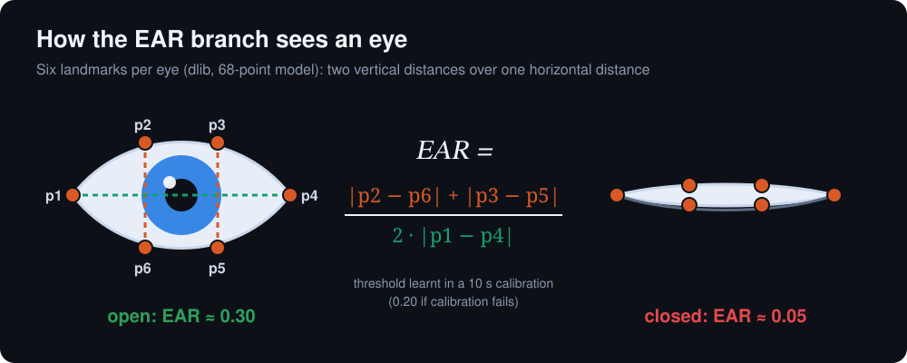
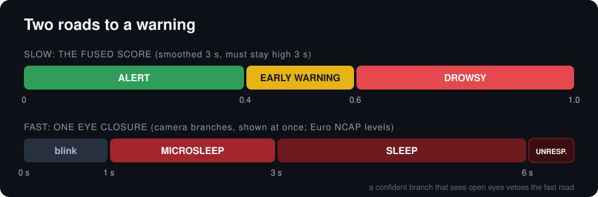
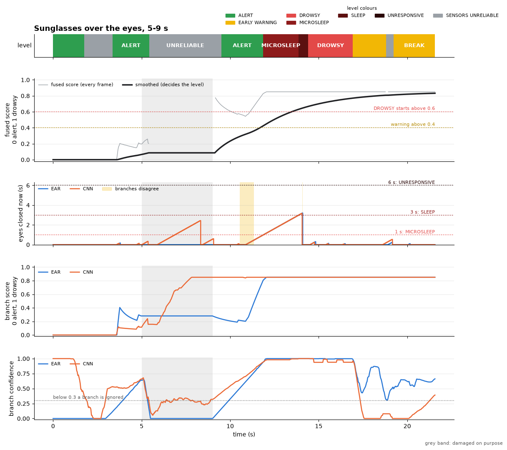
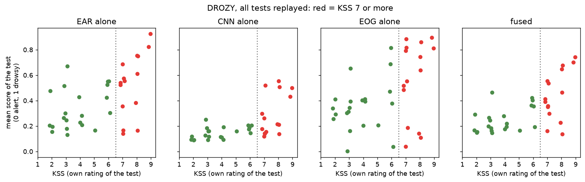

<div align="center">



[](https://github.com/notchkillerAI/multimodal-drowsiness-detection/actions/workflows/tests.yml)


[Features](#-features) · [How it works](#-how-it-works) · [Quick start](#-quick-start) · [Dashboards](#-the-dashboards) · [Results](#-results) · [Project layout](#-project-layout) · [Credits](#-credits-data-models-and-references) · [Licence](#-licence)



<sub>The EOG-only dashboard replaying a recorded test of a sleepy person (self-rating 9 of 9). The camera dashboards look the same, with the live picture added.</sub>

</div>

---

## ✨ Features

- **Three independent branches, one contract.** Each sensor produces the same output, `{score, confidence, raw, timestamp}`:
  - **EAR**: eye aspect ratio from 68 face landmarks (dlib), with a 10-second per-user calibration.
  - **DL eye-state network**: a MobileNetV3 trained in this project on the MRL Eye dataset (97.2 % on 8 people it never saw), run with ONNX Runtime.
  - **EOG / EMG**: eye events detected in the electrode signal and compared with the person's own normal blink pattern.
- **Confidence-weighted fusion.** A branch that cannot see (no face, darkness, sunglasses, a flat electrode) loses its vote. When too little is left, the system says *sensors unreliable* instead of guessing.
- **Warning logic modelled on the industry rules.** Closure levels at 1 s, 3 s and 6 s follow the Euro NCAP driver-engagement protocol. Smoothing, hysteresis, persistence, a microsleep fast path and a recovery sequence keep the output steady.
- **Four dark-themed browser dashboards** (EAR only, DL only, EOG only, multimodal). Each runs on the live camera or a pre-recorded dataset, with live charts, adjustable thresholds, an alarm sound and CSV export.
- **Live and replay share one code path.** Recordings are streamed with their original timestamps through the same code as the camera, so the detector cannot tell a replay from a live run.
- **Honest evaluation.** Leave-one-person-out tests, 95 % intervals resampled by person, and a plain list of what has *not* been validated.
- **About 100 unit tests**, ruff lint, and notebook execution tests.

## 🧠 How it works



<p align="center"></p>

<p align="center"></p>

| Step | What it does | Why |
|---|---|---|
| **Weighted vote** | `fused = Σ wᵢ·confᵢ·scoreᵢ / Σ wᵢ·confᵢ` (default trust: camera 0.25 each, EOG 0.30) | an unsure branch counts less, a blind one not at all |
| **Smoothing** | exponential average, 3 s | one noisy frame cannot raise an alarm |
| **Hysteresis** | DROWSY above 0.6, clears below 0.4 (warning 0.4 / 0.3) | no flickering around a single threshold |
| **Persistence** | score must stay high for 3 s | sustained drowsiness, not a blink |
| **Microsleep rule** | eyes closed ≥ 1 s → MICROSLEEP, ≥ 3 s → SLEEP, ≥ 6 s → UNRESPONSIVE, immediately | Euro NCAP closure levels; vetoed by a confident branch that sees open eyes |
| **Disagreement rule** | two confident camera branches that contradict each other are not averaged into DROWSY | e.g. looking down fools one network |
| **Recovery** | red ends 2.5 s after the eyes reopen, then yellow "take a break" while the score stays high | a clear but calm way back to green |

<details>
<summary><b>Damage test: what happens when a sensor is blinded on purpose</b></summary>



Sunglasses over the eyes from 5 to 9 s (grey band): both camera branches lose confidence, and the level becomes *sensors unreliable* instead of a false ALERT. When the eyes are visible again, a real 3 s closure gives MICROSLEEP and then SLEEP at once.
</details>

## 🚀 Quick start

Tested on macOS (Apple Silicon) with Python 3.14; any Python ≥ 3.12 should work.

```bash
git clone https://github.com/notchkillerAI/multimodal-drowsiness-detection.git
cd multimodal-drowsiness-detection
make setup      # .venv + all packages (dlib builds from source, about 3 minutes, needs cmake)
make models     # downloads the face detector and the landmark model into models/
make test       # fast tests
```

The **DL eye-state model** is trained here rather than downloaded (`models/eye_state.onnx`, not in git). Training downloads the MRL Eye dataset and takes about 10 minutes:

```bash
.venv/bin/pip install -r requirements-train.txt
.venv/bin/python train_eye_model.py train small 80 14
cp models/eye_state_small_80.onnx models/eye_state.onnx
```

Without it, everything else runs; the dashboard shows the DL branch as unavailable.

> **Camera permission (macOS):** System Settings › Privacy & Security › Camera › allow your browser (for the dashboards) or your terminal (for the command-line tools).

## 🖥️ The dashboards

```bash
python apps/multimodal.py    # EAR + DL + EOG fused
python apps/ear_only.py      # EAR only
python apps/dl_only.py       # DL only
python apps/eog_only.py      # EOG only (no camera)
python apps/run_all.py       # all four at once on ports 8000-8003
```

The page opens at <http://localhost:8000>. Pick an **input** and press **Start**:

| Mode | Live input | Pre-recorded input |
|---|---|---|
| EAR only, DL only | camera | a video file in `data/`, or a DROZY test video |
| EOG only | EOG device (`--sensor serial` or `--sensor lsl`) | a DROZY test's EOG channel, or a DD-Database recording (1×, 10×, 60×) |
| Multimodal | camera (+ EOG device if given) | a DROZY test (video + EOG on one clock), or a video file |

While it runs you can move the DROWSY threshold, the persistence and the smoothing, switch branches on or off and change their weights, recalibrate EAR, reset the fusion, mute the alarm and download the run as CSV.

<details>
<summary><b>How the dashboard is built</b></summary>

- A plain Python standard-library HTTP server (`drowsiness/dashboard/server.py`) and one HTML/JS page; there is no web framework.
- **Live camera:** the browser opens the camera and sends one small JPEG at a time. Frames are analysed in memory and never saved.
- **Recordings and the EOG device** are read on the server with their own timestamps (`recordings.py`), and the page asks for the newest result.
- Both paths call the same `Session.process`, so the branches and the fusion are exactly those used everywhere else.
- Measured on an M-series MacBook Air: 30 fps live, a 27 ms round trip per frame, and about 25 ms per frame for a DROZY test in multimodal mode.
- Keep a live-camera tab visible: browsers slow hidden tabs to about 1 fps, and the page warns you when that happens.
- `python apps/x.py` restarts itself with `.venv/bin/python` (so it works from conda too). If a port is busy, it takes the next free one.
</details>

<details>
<summary><b>Command-line tools and notebooks</b></summary>

```bash
python -m drowsiness.video.ear_branch --source 0                       # live HUD in a window, q quits
python -m drowsiness.video.cnn_branch --source my_video.mov --log-csv runs/cnn.csv
python -m drowsiness.fusion.drozy_replay --subject 4 --test 3           # DROZY replay, all three branches
python -m drowsiness.fusion.drozy_eval                                  # full DROZY evaluation
```

| Notebook (`notebooks/`) | What it shows |
|---|---|
| `EAR_Detection.ipynb` | EAR branch on an image, a video and the live camera |
| `DL_classifier.ipynb` | eye-state model comparison and the DL branch |
| `EOG_EDA.ipynb` | EOG data exploration, eye events, features, leave-one-person-out training |
| `EOG_Detection.ipynb` | the finished EOG detector, replay and live sensor |
| `multimodal_drowsiness_detection.ipynb` | fusion: branches on/off, damage tests, DROZY replay |

Run `.venv/bin/python -m ipykernel install --user --name driver-venv --display-name "Driver Drowsiness (.venv)"` and pick that kernel.
</details>

<details>
<summary><b>Connecting your own EOG device</b></summary>

`LiveEogBranch` (`drowsiness/bio/eog_branch.py`) accepts any source with `start()`, `read()` and `stop()`. A serial-port reader and a Lab Streaming Layer reader are included (`drowsiness/bio/sensors.py`):

```bash
python apps/eog_only.py --sensor serial --serial-port /dev/tty.usbmodem1101 --sample-rate 250 --to-microvolts 0.5
```

This path has been tested with a simulated sensor only. The EOG model was trained on another electrode pair, so expect to re-fit it for a new device.
</details>

## 📊 Results

**Eye-state model:** four candidates, tested on the same 6000 MRL Eye images of 8 held-out people (full table in [`docs/eye_model_comparison.md`](docs/eye_model_comparison.md)):

| Model | Params | Accuracy | Closed eye called open | Open eye called closed | CPU ms / eye |
|---|---|---|---|---|---|
| OpenVINO open-closed-eye-0001 (the original model) | 0.05 M | 57.6 % | 100 % | 0.1 % | 0.1 |
| ViT-base (Hugging Face) | 86 M | 99.2 % | 1.3 % | 0.5 % | 48.1 |
| **MobileNetV3-Small, fine-tuned here** | **1.5 M** | **97.2 %** | **1.1 %** | **4.0 %** | **0.8** |

The ViT is a little more accurate but 60 times slower, and it was probably trained on data related to MRL. The MobileNetV3 was chosen because it runs comfortably in real time.

**DROZY:** all 36 ten-minute tests (14 people) replayed through every branch and scored against each person's own sleepiness rating (KSS ≥ 7 = sleepy):



| Method | AUC [95 % interval, resampled by person] | Spearman ρ with KSS |
|---|---|---|
| EAR alone | 0.74 [0.54, 0.96] | +0.52 |
| DL alone | 0.80 [0.61, 0.93] | +0.66 |
| EOG alone (model from another dataset, no retraining) | 0.70 [0.46, 0.91] | +0.38 |
| Majority vote | 0.79 [0.66, 0.92] | +0.61 |
| **Weighted fusion (default weights)** | **0.79 [0.63, 0.96]** | **+0.59** |
| Weighted fusion, weights tuned leave-one-person-out | 0.78 [0.60, 0.93] | +0.65 |

> **Read this honestly:** every interval overlaps every other, so with 14 people no method is shown to beat another. Fusion is meant for robustness (a lost camera or electrode) and for the microsleep rules, which a per-test rating cannot test. Tuning the weights gave no gain on held-out people, so the defaults are kept.

<details>
<summary><b>More measurements and known limits</b></summary>

- **Speed** (Apple Silicon, CPU, per frame): EAR 7 ms, DL 6.7 ms (2.3 ms per eye with the Core ML provider).
- **EOG model** (DD-Database, 7 people, leave-one-person-out): AUC 0.65 ± 0.06. It works as a trend indicator, not as an alarm on its own.
- **DROZY as a yes/no per test:** 9 of 15 sleepy tests found, 16 of 21 alert tests cleared. Five sleepy tests stay mostly ALERT (5-2, 5-3, 10-3, 14-2, 14-3). One alert test (6-2) spends 81 % of its time in EARLY WARNING.
- **Warm start of the EOG:** the person's earlier test serves as a calibration drive, so the branch is ready from the first second, with its confidence rising over 2 minutes.
- **Known weak spot:** looking down with the eyes only is read as "closed" by the DL model and as "open" by EAR. The disagreement rule limits the damage, but the real fix needs labelled examples (`python -m drowsiness.video.clips record` collects them).
- **Not validated:** KSS-calibrated thresholds, a real EOG/EMG device (only a simulated sensor has been tested), the Euro NCAP test conditions (lighting, eyewear, skin types), and real driving. The camera tests involve one person.
- The warning timings follow Euro NCAP *Safe Driving – Driver Engagement* v1.2 and EU Delegated Regulation 2021/1341. This is a **laptop prototype, not a type-approved safety system**.
</details>

## 📁 Project layout

```
drowsiness/
  common/     branch.py (the interface every branch follows), windowing.py (closures, PERCLOS, score, confidence)
  video/      ear_branch.py, cnn_branch.py, capture.py, hud.py, runner.py, zoom.py, clips.py, stream.py
  bio/        eye_events.py (EOG/EMG detector + model), eog_branch.py, sensors.py, synthetic.py, drozy.py
  fusion/     fuse.py (the fusion), drozy_replay.py, drozy_eval.py
  dashboard/  server.py, session.py, recordings.py, static/ (the page)
apps/         ear_only.py · dl_only.py · eog_only.py · multimodal.py · run_all.py
notebooks/    five notebooks (EAR, DL, EOG exploration, EOG detector, fusion)
tests/        unit tests; test_notebooks.py runs every notebook (pytest -m slow)
docs/         figures and the eye-model comparison
```

`data/`, `models/` and `runs/` stay on your machine. No dataset, model file or face picture is in this repository.

## 🙏 Credits: data, models and references

This project uses the following third-party work. Their files are **not** redistributed here; each script downloads them from the original source, or you obtain them yourself under their own terms.

### Datasets

| Dataset | Used for | Licence / terms | Citation |
|---|---|---|---|
| **DROZY**, ULg Multimodality Drowsiness Database | replay and evaluation (video + EOG + KSS) | research and evaluation only, no redistribution (agreement in the archive); get it from [ORBi](https://orbi.uliege.be/handle/2268/191620) | Q. Massoz, T. Langohr, C. François, J. G. Verly, "The ULg multimodality drowsiness database (called DROZY) and examples of use," *IEEE WACV*, 2016. |
| **DD-Database**, Drivers Drowsiness Database | training the EOG model | [CC0 1.0](https://zenodo.org/records/8284057) | L. Orosco, M. A. Garcés, G. E. Cañadas Fragapane, C. Dell'Aquila, J. C. Iturrieta Gimeno, E. Laciar Leber, *Drivers Drowsiness Database*, 2023, doi:10.5061/dryad.5tb2rbp9c. |
| **MRL Eye Dataset** | training the eye-state network | see the [dataset page](http://mrl.cs.vsb.cz/eyedataset) for terms; downloaded by `train_eye_model.py`, never redistributed | R. Fusek, "Pupil localization using geodesic distance," *ISVC 2018*, LNCS 11241, Springer. |

### Models

| Model | Used for | Licence / terms |
|---|---|---|
| dlib `shape_predictor_68_face_landmarks` | EAR landmarks | dlib is Boost-licensed. The model was trained on iBUG 300-W, whose licence **excludes commercial use** (C. Sagonas et al., "300 Faces in-the-Wild Challenge," *ICCV Workshops*, 2013; V. Kazemi, J. Sullivan, *CVPR*, 2014). |
| YuNet face detector (OpenCV Zoo) | face box for the DL branch | MIT (W. Wu, H. Peng, S. Yu, "YuNet: A tiny millisecond-level face detector," *Machine Intelligence Research*, 2023). |
| MobileNetV3 ImageNet weights (torchvision) | starting point for the eye-state network | BSD-3-Clause (A. Howard et al., "Searching for MobileNetV3," *ICCV*, 2019). |
| OpenVINO `open-closed-eye-0001` | baseline in the comparison only | Apache-2.0 (Intel Open Model Zoo). |
| ViT and MobileNetV2 eye models (Hugging Face) | compared only, not used | Apache-2.0 and CC BY-NC-ND 4.0, see each model card. |

### Methods and rules

- T. Soukupová, J. Čech, "Real-time eye blink detection using facial landmarks," *CVWW*, 2016 (the EAR formula).
- D. F. Dinges, R. Grace, *PERCLOS: A valid psychophysiological measure of alertness*, FHWA-MCRT-98-006, 1998.
- I. Beles et al., "Driver drowsiness multi-method detection for vehicles with autonomous driving functions," *Sensors* 24(5), 1541, 2024 (the multi-sensor fusion design that inspired this one).
- T. Åkerstedt, M. Gillberg, "Subjective and objective sleepiness in the active individual," *Int. J. Neuroscience*, 1990 (the KSS scale).
- Euro NCAP, *Safe Driving – Driver Engagement* protocol v1.2; EU Delegated Regulation (EU) 2021/1341 (warning timings).

### Libraries

NumPy, SciPy, pandas, scikit-learn (BSD-3) · OpenCV (Apache-2.0) · dlib (BSL-1.0) · ONNX Runtime (MIT) · Matplotlib (PSF-based) · pyEDFlib (BSD-2) · pySerial (BSD-3) · pylsl (MIT) · PyTorch, torchvision (BSD-3) · ONNX (Apache-2.0) · Hugging Face Transformers (Apache-2.0) · pytest (MIT) · Ruff (MIT).

## 📄 Licence

The **code** in this repository is released under the [MIT licence](LICENSE). Datasets and downloaded models keep their own terms (above): in particular, DROZY may not be redistributed and the dlib landmark model is not for commercial use.

If you use this project, please cite it via [`CITATION.cff`](CITATION.cff) (GitHub's *Cite this repository* button).

<div align="center"><sub>B.Tech project by Arpan Bhattacharya · built with Python, OpenCV and ONNX Runtime</sub></div>
